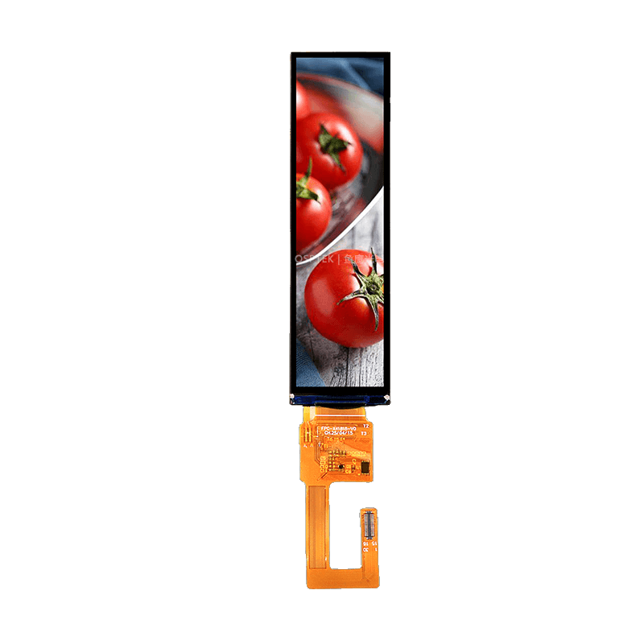

<p align="left"></p>

<h1 align="center">OSPTEK 3.82″ TFT 显示屏 280×1020（YDP382B001-V13）</h1>

<p align="center"><b>TFT 模组 · MIPI · AXS15231B</b></p>

<p align="center"><a href="./README_EN.md">English</a> | 简体中文 · <a href="../../README.md">规格族索引</a></p>

<p align="center">
  
  
</p>

<p align="center"></p>

## 目录

- [规格参数](#规格参数)
- [相关资料](#相关资料)
- [仓库结构](#仓库结构)
- [购买链接](#购买链接)
- [技术支持](#技术支持)

---

## 规格参数

| 项目 | 规格 |
| ---- | ---- |
| 尺寸 | 3.82 英寸 |
| 类型 | TFT |
| 分辨率 | 280×1020 |
| 外形尺寸 | 28.11 x 98.85 mm |
| 有效显示区域 | 25.7 x 93.636 mm |
| 接口 | MIPI |
| 驱动 IC | AXS15231B |
| 触摸驱动 | — |

> 完整外形尺寸、FPC 定义、供电与时序以产品规格书 / 驱动手册为准。

## 相关资料

| 分类 | 文件 |
| ---- | ---- |
| 规格文档 | [`AXS15231B_Datasheet_V0.5_20230306－客户版(2).pdf`](./datasheets/AXS15231B_Datasheet_V0.5_20230306%EF%BC%8D%E5%AE%A2%E6%88%B7%E7%89%88%282%29.pdf) |
| 规格文档 | [`YDP_382_B001_V13_9b4d899817.pdf`](./datasheets/YDP_382_B001_V13_9b4d899817.pdf) |
| CAD 图纸 | [`YDP382B001-V13.dwg`](./cad/YDP382B001-V13.dwg) |
| CAD 图纸 | [`YDP382B001-V13_外形图.pdf`](./cad/YDP382B001-V13_%E5%A4%96%E5%BD%A2%E5%9B%BE.pdf) |

## 仓库结构

```text
display-tft-3.82inch-280x1020/ # 仓库根（导航见 ../../README.md，示例工程见根目录 examples/）
└── versions/
    └── YDP382B001-V13/        # 本料号完整资料
        ├── README.md
        ├── README_EN.md
        ├── osptek.yml
        ├── images/
        ├── datasheets/       # 产品规格书 + 驱动/触摸 IC 数据手册
        └── cad/              # 外形/盖板 CAD
```

## 购买链接

见[仓库首页](../../README.md#购买链接)。

## 技术支持

见[仓库首页](../../README.md#技术支持)。

---

<p align="center"><sub>© 2026 OSPTEK 鱼鹰光电 · 本仓库资料采用 CC BY 4.0 许可</sub></p>
